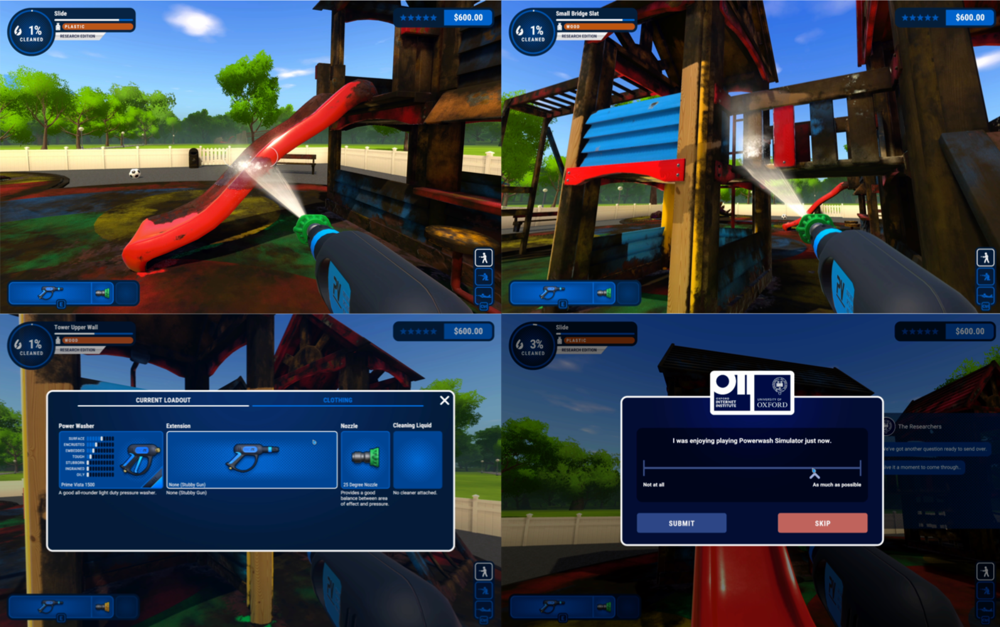

```{r setup, include = FALSE}
# Packages
library(papaja)
library(scales)
library(lubridate)
library(citr)
library(janitor)
library(ggbeeswarm)
library(ggrepel)
library(patchwork)
library(duckdb)
library(dbplyr)
library(readxl)
library(tidyverse)
knitr::opts_chunk$set(
  include = FALSE,
  message = FALSE,
  warning = FALSE,
  cache = TRUE
)
options(knitr.kable.NA = '')
theme_set(
  theme_linedraw() +
    theme(
      panel.grid.minor = element_blank(),
      panel.grid.major = element_line(linetype = "dotted")
    )
)
```

```{r data}
#| cache: false
# Todo: for now read data from elsewhere on user's drive
path <- Sys.getenv("PWS_DATA_PATH")

duck_path <- paste0(path, "/data/data.duckdb")
duck <- dbConnect(
  duckdb(), 
  dbdir = duck_path, 
  read_only = TRUE
)
events <- read_excel(
  paste0(path, "/codebook.xlsx"), 
  sheet = "Events & Variables"
) %>% 
  fill(EventName)
```

```{r summary}
# All data
demo <- tbl(duck, "demographics") %>% collect()

# Number of subjects
n_players <- nrow(demo) %>% number(big.mark = ",")

# Age interquartile range
age_iqr <- quantile(demo$age, probs = c(0.25, 0.75), na.rm = TRUE) %>% 
  paste(collapse = ", ")

# Number of different events
# Count only behavioural events, not e.g. automatic data dumps like game_saved
n_events <- length(unique(events$EventName))
events_game <- c(
  "exited_game", 
  "item_purchased", 
  "job_completed", 
  "job_exited", 
  "job_resumed", 
  "job_started",
  "opted_in", 
  "opted_out",
  "player_logged_in",
  "subtask_completed",
  "task_completed"
)
n_events_game <- length(events_game)
events_survey <- c("mood_reported", "study_prompt_answered")
n_variables <- length(unique(events$Variable))
obs_per_event <- tibble(
  EventName = c(events_game, events_survey)
) %>% 
  mutate(
    rows = map_dbl(
      EventName, 
      ~tbl(duck, .x) %>% 
        tally() %>% 
        collect() %>% 
        pull(n)
    )
  )

obs_per_event_game <- obs_per_event %>% 
  filter(EventName %in% events_game) %>% 
  summarise(n = sum(rows)) %>% 
  pull(n) %>% 
  number(big.mark = ",")
obs_per_event_survey <- obs_per_event %>% 
  filter(EventName %in% events_survey) %>% 
  summarise(n = sum(rows)) %>% 
  pull(n) %>% 
  number(big.mark = ",")

dat_survey <- bind_rows(
  tbl(duck, events_survey[[1]]) %>% collect(),
  tbl(duck, events_survey[[2]]) %>% collect()
)
```

---
abstract: |
  The potential impacts that video games might have on players' well-being and mental health are under increased scrutiny but poorly understood empirically. Although extensively studied, a level of understanding required to address concerns and advice policy is lacking, at least partly because much of this science has relied on artificial settings and limited self-report data. We describe a large-scale and detailed dataset of video game play behaviors and events paired with well-being and motivation reports. `r n_players` (age IQR: [`r age_iqr`]) players of the first person powerwasher PC game PowerWash Simulator volunteered for an experimental version of the game that logged their play behaviors across `r n_events_game` different in-game behaviors and events (e.g. task completion) and `r n_variables` variables (e.g. amount of credit at the time of event), and asked psychological survey instruments via in-game pop-ups. The data consists of `r obs_per_event_game` gameplay events and `r obs_per_event_survey` survey item responses.
---

# Background & Summary

Video games offer billions of players [@newzooNewzooGlobalGames2021], worldwide, opportunities for enjoyment, relaxation, competition, achievement, and socializing [@bowmanSocialVideoGaming2022; @halbrookWhenHowVideo2019]. Although video game play has been studied for decades[@markey2020video], and despite widespread worries and hopes about games' potential consequences[@kollinsNovelDigitalIntervention2020; @mentzoniProblematicVideoGame2011] and recent policy decisions to address those[@aarsethScholarsOpenDebate2017; @bbcnewsChinaCutsChildren2021; @kardefelt-wintherCriticalAccountDSM52015], scientists are still uncertain about the psychological effects of play. 

As much of past studies have been limited by inaccurate self-report measures of play [@kahnWhyWeDistort2014; @parrySystematicReviewMetaanalysis2021], recent efforts have focused on behavioral telemetry data---data that are automatically collected by online game platforms and includes player behaviors and in-game events [@johannesTimeSpentPlaying2022; @johannesVideoGamePlay2021; @vuorreLargeScaleStudyChanges2021; @vuorreTimeSpentPlaying2022]. While accurate, that telemetry, or what is made available of it, is typically limited to session-aggregated play time and doesn't include more detailed data on players' behaviors and events. As a consequence, while these recent studies were able to measure the amount of play with great accuracy, the quality of play---players' behaviors and in-game events---remained unknown.

We describe a longitudinal study of video game play, well-being, and motivations, and the resulting large scale dataset that includes an unprecedented level of detail about `r n_players` players' in-game play behaviors and events, in combination with their responses psychological survey instruments, over `r round(diff(range(dat_survey$Time_utc)))` days of game play. (The numbers reported in this manuscript reflect version 1.0 of the dataset [on `r Sys.Date()`; cite repository DOI]; the study is ongoing until further notice.) This study implemented a modified version of a commercially available game that queried participating players' psychological states during play using in-game popups. The combination of detailed play behavior and event data, and players' responses to psychological instruments within the game itself, is a first of its kind dataset and is suitable for both detailed descriptive studies and in-depth statistical modelling of video game play and its relations to players' psychological states. 

# Methods

In this study, we developed a modified version of a commercial video game, and made it available on the same commercial platform (Steam) as the original game. Interested players recruited through various channels opted in to the research version, downloaded it as they would have the regular version, and gave informed consent to the study and data donation. We first describe the game and the modifications in the research version, then the recruitment process, and then the psychological survey instruments that we used.

## PowerWash Simulator

Our main instrument was an experimental version of PowerWash Simulator (PWS)[@futurlabPowerWashSimulatorFuturLab2022], a first-person powerwasher game (see Figure \@ref(fig:fig-pws-play)). In PWS, players control a character whose task is to use a powerwasher to clean various objects in different environments. The main game offers a career mode, in which the player progresses through different levels (a garage with a single car to be washed, then a backyard with many objects, etc.) by cleaning all the dirty objects in the level. As the players progress, they earn credit, which they can use to buy new nozzles, soaps, and various cosmetic enhancements.

```{r}
#| label: fig-pws-play
#| include: true
#| fig-cap: 'Screenshots of PowerWash Simulator gameplay. Top left: Powerwashing a slide in the Playground level. B. Powerwashing other playground equipment. C. Choosing a power washer, extension, and nozzle. D. Providing an Enjoyment response using the in-game pop-up VAS. An illustrative video of the actual gameplay on the research branch of PWS is available on YouTube [@futurlabPowerWashSimulatorLaunch2022].'

```

Before the game was released on Steam, we collaborated with PWS's developer, FuturLab, to implement and make public a modified version of the main game. The academic researchers in our team created the conceptual design of the modifications to the main game, which JB then implemented. That research branch was identical to the main game, except for the following changes: First, it sent detailed game play data (see Data records, below) to the PlayFab back-end service, from which we continuously exported all data to an Amazon Web Services storage bucket for more permanent storage. 

Second, the experimental branch of the game was programmed to surface questions about the players' psychological experiences and states during play using an in-game messaging and response system (Figure \@ref(fig:fig-pws-play)D, and Data records, below). Players' responses to those prompts were sent directly to the academic researchers' Qualtrics database, to which FuturLab members had no access. This ensured the privacy of the participants' survey responses, even from the game developers. 

The research version also featured a "Research edition" text in the main menu, to remind players that they are in the experimental version, and a button to return to the regular version. Finally, although the main game had a multiplayer mode, we disabled that in the research version.

## Survey materials

The research version of PWS was programmed to surface psychological survey items to the player during game. These questions appeared as in-game pop-ups six times per hour of active game play, but with the constraint that they would be at least five minutes apart. Immediately before a survey question appeared, an in-game communication pop-up informed the participant that there would be a survey question soon (seen in the background of Figure \@ref(fig:fig-pws-play)D partly behind the VAS). All responses were optional and players could always click a "Skip" button. There were six different questions, but each pop-up included one item only, chosen at random from the six alternatives. Participants responded to all using a 1000px visual analog rating scale (VAS). We show the questions and their associated samples sizes in Table \@ref(tab:tbl-summary-survey).

```{r}
#| label: tbl-summary-survey
#| include: true

dat_survey %>% 
  rename(Item = LastStudyPromptType) %>% 
  group_by(Item, pid) %>% 
  mutate(pid_n = n()) %>% 
  group_by(Item) %>% 
  summarise(
    Observations = n(),
    Players = length(unique(pid)),
    `Mdn(o/p)` = as.character(median(pid_n))
  ) %>% 
  adorn_totals() %>% 
  mutate(
    across(-Item, ~number(as.numeric(.x), big.mark = ","))
  ) %>% 
  replace_na(list("Mdn(o/p)" = " ")) %>% 
  apa_table(
    digits = 0,
    span_text_columns = FALSE, 
    font_size = "small",
    midrules = nrow(.) - 1,
    caption = "Counts of survey item responses",
    note = "Mdn(o/p): Median observations per player."
  )
```

We queried subjective well-being with *"How are you feeling right now?"* with VAS endpoints *"Very bad"* and *"Very good"* [@killingsworthWanderingMindUnhappy2010]. Although feelings of well-being are often measured with separate positive and negative affect dimensions, our study required the least intrusive item possible to not disrupt play more than was necessary, and we therefore used the simple "happiness" question from @killingsworthWanderingMindUnhappy2010. Furthermore, such single-item measures have been found to have good validity and are recommended in intensive longitudinal studies [@songExaminingConcurrentPredictive2022]. 

In order to capture the intrinsically motivating qualities of game play, we queried for "Enjoyment" with *"I was enjoying playing Powerwash Simulator just now."* with VAS endpoints *"Not at all"* to *"As much as possible"* [@johannesVideoGamePlay2021; @johnsonValidationTwoGame2018; @ryanMotivationalPullVideo2006]. 

We were also interested in the broad concept of being focused on playing the game, both in terms of a positively valenced absorption [@csikszentmihalyiFlowPsychologyOptimal2009; @martinBriefApproachesAssessing2008], and a more "meditative" quality of attending rather than allowing one's mind to wander [@mrazekMindfulnessMindwanderingFinding2012; @schoolerMetaawarenessPerceptualDecoupling2011]. We measured this quality of focusing on game play with the prompt *"I was totally focused on playing Powerwash Simulator just now."* and a VAS from *"Not at all"* to *"As much as possible"*.

We also queried for players feelings of autonomy, the degree to which they felt autonomous in their decisions of how to play and what to do in the game, with *"Just now, I was doing the things I really wanted to in Powerwash Simulator"* with VAS endpoints *"Not at all"* and *"As much as possible"*. We queried their feelings of competence with *"Just now, I felt competent playing PowerWash Simulator"*, and feelings of immersion with *"Just now, I felt completely immersed in PowerWash Simulator"*, both with the same VAS as the autonomy item.

```{r}
#| label: fig-response-data
#| include: true
#| fig-height: 6.4
#| fig.cap: "Survey response volumes over time. A. Counts of daily survey responses and unique players responding to survey items over time. B. Mean counts of survey item observations and unique players over the days of a week. C. Total responses on each day of the week and each hour of the day. All numbers in A-C indicate counts of survey responses only, and not other game play behavior data."
p_timeline <- dat_survey %>% 
  mutate(
    Date = floor_date(Time_utc, "day")
  ) %>% 
  group_by(Date) %>% 
  summarise(Observations = n(), Players = length(unique(pid))) %>% 
  pivot_longer(-Date) %>% 
  ggplot(aes(Date, value)) +
  scale_y_continuous(
    "Count",
    labels = ~number(., big.mark = ",")
  ) +
  scale_x_datetime(
    "Date",
    date_breaks = "2 week", date_labels = "%Y\n%b-%d",
    date_minor_breaks = "week", 
    expand = expansion(0.01)
  ) +
  geom_line(linewidth = 0.8) +
  facet_wrap("name", ncol = 1, scales = "free_y") +
  theme(axis.text.x = element_text(size = rel(0.86)))

p_week <- dat_survey %>% 
  mutate(
    Date = floor_date(Time_utc, "day"),
    Weekday = wday(Time, week_start = 1, label = TRUE, abbr = TRUE)
  ) %>% 
  group_by(Weekday, Date) %>% 
  summarise(
    Observations = n(), 
    Players = length(unique(pid))
  ) %>% 
  summarise(
    Observations = mean(Observations), 
    Players = mean(Players)
  ) %>% 
  pivot_longer(c(Observations, Players)) %>% 
  ggplot(aes(Weekday, value)) +
  scale_colour_viridis_d(direction = -1) +
  scale_y_continuous(
    "Mean count",
    labels = ~number(., big.mark = ",")
  ) +
  scale_x_discrete(
    expand = expansion(0.01)
  ) +
  geom_line(linewidth = 0.8, group = 1) +
  facet_wrap("name", ncol = 1, scales = "free_y") +
  theme(
    axis.title.y = element_blank(), 
    axis.text.x = element_text(size = rel(0.86))
  )

p_hour <- dat_survey %>% 
  mutate(
    Hour = hour(Time),
    Weekday = wday(Time, week_start = 1, label = TRUE, abbr = TRUE)
  ) %>% 
  group_by(Weekday, Hour) %>% 
  summarise(
    Observations = n()
  ) %>% 
  ggplot(aes(Hour, Observations, col = Weekday)) +
  scale_colour_viridis_d(direction = -1) +
  scale_y_continuous(
    "Responses",
    labels = ~number(., big.mark = ",")
  ) +
  scale_x_continuous(
    breaks = seq(0, 22, by = 2),
    expand = expansion(0.01)
  ) +
  guides(
    color = guide_legend(
      nrow = 1, override.aes = list(linewidth = 1.4))
  ) +
  geom_line(linewidth = 0.8) +
  theme(legend.position = "bottom")

((p_timeline | p_week) + plot_layout(widths = c(6.8, 3.2))) /
  p_hour +
  plot_annotation(tag_level = "A")
```

The items were surfaced with equal probabilities, but the three latter motivation items were added later in the experiment. In addition, at every login, there was a 10% probability that the player was asked the well-being item. We summarize the volumes of participants' responses to the survey items in Figure \@ref(fig:fig-response-data).

## Participant recruitment

The main PWS game is available on the Steam platform (at £19.99 on 2022-11-16). Potential participants were initially made aware of the research version of PWS on social media in August of 2022. Both FuturLab and Oxford Internet Institute also hosted websites that advertised the study and instructed potential participants on how to sign up to the study.[@futurlabPowerWashSimulatorResearch2022; @oxfordinternetinstituteOIIResearchersOxford2022] The launch of this study was also noted in news media[@mottPowerWashSimulatorPlayers2022], which may have driven participation.

<!-- Add here details on second wave launch when appropriate. -->

To participate, players were asked to use Steam to sign up for a different branch of the game. They then downloaded the research branch version. After their first log-in, but before entering the game menu, participants read our consent form, and indicated that they were 18 years or older, and agreed to voluntarily participate in the game. They then answered basic demographic questions and proceeded to play as usual, but with the differences in the game design as discussed in the PWS section.

Then, in a second wave of recruitment in December 2022, the main branch of the game was modified to include a menu button inviting players to participate in the experimental branch (screenshot!).

After participants joined the research branch of PWS, they were free to withdraw from the study at any point and return to the main branch of the study (or stop playing PWS entirely), and request to have their data deleted. 

# Data Records

## Participants

```{r}
# Summarise gender
xd <- demo %>% 
  count(gender) %>% 
  replace_na(list(gender = "Declined")) %>% 
  mutate(x = str_glue("{gender}: {n}")) %>% 
  pull(x)
```

```{r}
#| label: fig-participation-data
#| include: true
#| fig-height: 3
#| fig.cap: Summary of each participant's contribution to the study. A. Player participation durations. B. Numbers of survey responses.
x <- dat_survey %>% 
  group_by(pid) %>% 
  summarise(
    min = min(Time_utc),
    max = max(Time_utc),
    `Survey responses` = n()
  ) %>% 
  mutate(
    `Study duration` = difftime(max, min, units = "days")
  ) %>% 
  select(-c(min, max)) %>% 
  pivot_longer(-pid, values_transform = as.numeric) %>% 
  group_by(name) %>% 
  filter(value < quantile(value, .99))
p_study_duration <- x %>% 
  filter(name == "Study duration") %>% 
  ggplot(aes(value)) +
  scale_y_continuous(
    "Participants",
    expand = expansion(c(0, 0.025))
  ) +
  scale_x_continuous(
    "Days between first and last response",
    expand = expansion(0.01)
  ) +
  geom_histogram(
    col = "dodgerblue4", 
    fill = "dodgerblue1", 
    alpha = .5, 
    bins = 50
  )
p_survey_responses <- p_study_duration %+% 
  filter(x, name == "Survey responses") +
  scale_x_continuous(
    "Number of survey responses",
    expand = expansion(0.01)
  ) +
  theme(axis.title.y = element_blank())

(p_study_duration | p_survey_responses) +
  plot_annotation(tag_level = "A") &
  theme(panel.grid = element_blank())
```

We defined a participant as anyone who provided informed consent, was over 18 years old, did not request their data to be deleted, and answered at least one survey item. `r nrow(demo)` players participated, with a median age of `r median(demo$age, na.rm = TRUE)` (10th and 90th percentile: `r quantile(demo$age, c(.1, .9), TRUE)`). The gender breakdown of our sample was as follows: `r paste(xd, collapse = ", ")`.

Because participants could withdraw from the research branch at any point, the duration of each player's participation in the study, and the volume of data contributed, could vary. Figure \@ref(fig:fig-participation-data) summarises each participant's contribution to the study.

The study procedures were granted ethical approval by Oxford University's Central University Research Ethics Committee (SSH_OII_CIA_21_011). All participants provided informed consent to participate and reported being 18 years or older.

## Game play data

```{r}
#| eval: false
tbl(duck, "subtask_completed") %>% 
  distinct(LastSubtaskCompleted) %>% 
  collect()
```

```{r}
#| label: fig-playday
#| include: true
#| fig.height: 7
#| fig.cap: Figure of one player's game play and survey data for one day. A. Distribution of game play behaviors and events throughout the day. The y-axis indicates different events and behaviors, individual points are observations of those events when they happened (time; x-axis). We jittered the subtask_completed events vertically for visibility. The text labels show example variable values for each event (job_started shows the job name; subtask_completed shows the subtask name). B. Survey responses over time. Lines are exploratory LOESS fits.

# Pick a person with plenty of data for an informative figure
ids <- dat_survey %>% 
  count(pid) %>% 
  arrange(desc(n)) %>% 
  slice(4) %>% 
  pull(pid)

x <- c(events_game, events_survey) %>% 
  map(
    ~tbl(duck, .) %>% 
      filter(pid %in% ids) %>% 
      collect()
  ) %>% 
  bind_rows() %>% 
  arrange(pid, Time)

x2 <- x %>% 
  mutate(day = yday(Time)) %>% 
  add_count(day) %>% 
  filter(n == max(n)) %>% 
  arrange(Time) %>% 
  mutate(EventName = fct_inorder(EventName))

date(x2$Time) <- as.Date("2022-01-01")
date(x2$Time_utc) <- as.Date("2022-01-01")

# Highlight a few responses
set.seed(3)
highlights <- x2 %>% 
  filter(EventName %in% c("study_prompt_answered", "subtask_completed", "job_started")) %>% 
  select(EventName, Time, LastSubtaskCompleted, CurrentJobName, LastStudyPromptType, response) %>% 
  group_by(EventName, LastStudyPromptType) %>% 
  slice_sample(n = 1) %>% 
  ungroup() %>% 
  mutate(x = factor(1:n())) %>% 
  mutate(
    label = case_when(
      EventName %in% events_survey ~ str_glue("{LastStudyPromptType} ({response})"),
      EventName == "subtask_completed" ~ LastSubtaskCompleted,
      EventName == "job_started" ~ CurrentJobName
    )
  ) %>% 
  replace_na(list(LastStudyPromptType = "Wellbeing"))

p_day_game <- x2 %>% 
  # filter(EventName %in% events_game) %>% 
  ggplot(aes(Time, EventName)) +
  scale_y_discrete(position = "right") +
  scale_x_datetime(
    date_breaks = "2 hours", date_labels = "%H:%M"
  ) +
  scale_alpha_manual(values = c(1, .2)) +
  scale_size_manual(values = c(1.75, .75)) +
  scale_color_brewer(palette = "Set1") +
  geom_point(
    position = position_quasirandom(
      groupOnX = FALSE, 
      varwidth = TRUE,
      width = .4
    ),
    aes(
      alpha = EventName == "subtask_completed",
      size = EventName == "subtask_completed"
    ),
    col = "dodgerblue1"
  ) +
  geom_point(
    data = highlights,
    col = "dodgerblue4",
    size = 2
  ) +
  theme(
    axis.title = element_blank(),
    legend.position = "none"
  )


p_day_survey <- x2 %>% 
  filter(EventName %in% events_survey) %>% 
  ggplot(aes(Time, response)) +
  scale_color_brewer(
    "Survey item", 
    palette = "Set1"
  ) +
  scale_x_datetime(
    date_breaks = "2 hours", date_labels = "%H:%M"
  ) +
  scale_y_continuous(
    "Response value",
    expand = expansion(0.15)
  ) +
  stat_smooth(
    data = . %>% anti_join(highlights),
    aes(group = LastStudyPromptType), 
    se = FALSE, span = 1, linewidth = .75, color = "dodgerblue4"
  ) +
  geom_point(size = 2, col = "dodgerblue1") +
  facet_wrap(
    "LastStudyPromptType", 
    ncol = 1, 
    strip.position = "left"
  ) +
  labs(
    caption = str_glue("Illustrative data for one participant (a {wday(x2$Time[[1]], label = TRUE, abbr = FALSE)}; distinct event types: {length(unique(x2$EventName))}, total rows = {nrow(x2)}).")
  ) +
  theme(legend.position = "none")

p_day_game <- p_day_game +
  geom_label_repel(
    data = highlights,
    aes(label = label),
    force_pull = 0.0001, fill = alpha("white", 0.5),
    size = 2.1, box.padding = 0.9, 
    min.segment.length = 0,
    segment.color = "dodgerblue4", 
    arrow = arrow(length = unit(0.04, "npc")),
    nudge_y = 1, nudge_x = -3,
    point.padding = 0.33
  )

(p_day_game / p_day_survey) +
  plot_annotation(tag_level = "A") +
  plot_layout(heights = c(3.5, 6.5))
# library(ggrepel)
```

The research version of PWS recorded `r n_variables` variables describing different facets of the player's status when triggered by one of `r n_events` in-game events or play behaviors. For example, when the player completed a subtask (e.g. washed a window frame of the mansion; a "subtask_completed" *event*), the game saved the current time (a *variable* with millisecond precision); the name of the subtask; the character's current posture (standing, crouching, or prone); the character's current coordinates in the level; which washer, nozzle, and extension the character was currently using; progression within the level (e.g. 80%); and the current game mode (e.g. career mode or free play). The events, and their associated total numbers of observations, are listed in Table \@ref(tab:tbl-summary-events). The events and variables are described in detail in the associated codebook [Zenodo DOI].

```{r}
#| label: tbl-summary-events
#| include: true
events_game %>% 
  c(., "game_saved") %>% 
  map(
    ~tbl(duck, .) %>% 
      count(EventName, pid, name = "pid_n") %>% 
      collect()
  ) %>% 
  bind_rows() %>% 
  group_by(EventName) %>% 
  summarise(
    Observations = sum(pid_n),
    Players = length(unique(pid)),
    `Mdn(o/p)` = as.character(median(pid_n))
  ) %>% 
  adorn_totals() %>% 
  mutate(
    across(-EventName, ~number(as.numeric(.x), big.mark = ","))
  ) %>% 
  replace_na(list("Mdn(o/p)" = " ")) %>% 
  apa_table(
    digits = 0,
    font_size = "small",
    span_text_columns = FALSE, 
    placement = "ht",
    midrules = nrow(.) - 1,
    caption = "Counts of game play events.",
    note = "Mdn(o/p): Median observations per player. Note, players could opt in and out multiple times."
  )

x <- bind_rows(
  tbl(duck, "opted_in") %>% collect(),
  tbl(duck, "opted_out") %>% collect()
) %>% 
  distinct(pid, EventName, Time)
```

However, not all variables were relevant to all events. Therefore, each event only triggered the saving of a subset of variables. In the above example, the subtask_completed *event* saved the values of 9 *variables*. The codebook explains which events were paired with which variables. We provide the dataset as a collection of tables, one for each event and only including the variables that were saved during that event. Therefore, for reconstructing more complex timeseries, users can fill relevant values forward or backward in time, wherever appropriate.

```{r}
#| label: tbl-summary-variables
#| eval: false
#| include: true
unique(events$EventName) %>% 
  map(
    ~tbl(duck, .) %>% 
      select(any_of(c(unique(events$Variable), "Time"))) %>% 
      summarise(across(everything(), ~sum(as.integer(!is.na(.))))) %>% 
      collect()
  ) %>% 
  bind_rows() %>% 
  summarise(across(everything(), ~sum(., na.rm = TRUE))) %>% 
  pivot_longer(
    everything(), 
    names_to = "Variable", 
    values_to = "Count", 
    values_transform = ~number(., big.mark = ",")
  ) %>% 
  apa_table(
    digits = 0,
    font_size = "small",
    span_text_columns = FALSE, 
    caption = "Counts of non-missing Variable values in data"
  )
```

# Technical Validation

All data was automatically logged either by the PlayFab telemetry collecting system, or sent to the Qualtrics API. Therefore the likelihood of human error was minimised at each step. Nevertheless, quality considerations remained due to various technical issues in the internet connection between the player's computer and PlayFab and Qualtrics, and to improperly configured system clocks on players computers. Therefore, when cleaning and joining the data sources, we ran a series of automated tests to ensure good data quality. These tests are available at [Zenodo DOI].

# Usage Notes

The database is already cleaned and readily analysed with statistical software. Here, we provide a brief conceptual example on how the data can be used to answer substantive questions. A recent report[@johannesVideoGamePlay2021] found that there is a positive yet exceedingly small positive relation between amount of game play and well-being, such that people who on average play more tend to report greater well-being.

These data can be readily used to replicate that finding. We loaded the "subtask_completed" and "study_promp_answered" tables from the DuckDB database, aggregated the data to numbers of subtasks completed and mean response values for each individual. We then drew scatterplots and calculated regression slopes to illustrate the associations between average daily subtasks completed, as a proxy for game engagement, and each of the six psychological measures included in the study. The results replicated [@johannesVideoGamePlay2021]; there was a positive correlation between well-being and game engagement (Figure \@ref(fig:fig-example), "Wellbeing").

```{r}
#| label: fig-example
#| include: true
#| fig.cap: An example use of the database showing scatterplots of players' mean item response and average game play engagement (mean subtasks completed per day). Points are individuals, the lines and numbers indicate regression slopes from a simple linear model predicting the outcome from log(mean number of subtasks completed). Code to produce this figure is included in the online repository of this manuscript [Zenodo DOI].

ta <- tbl(duck, "subtask_completed") %>% 
  mutate(day = day(Time)) %>% 
  count(pid, day) %>% 
  mutate(n = n) %>% 
  collect()
tb <- tbl(duck, "study_prompt_answered") %>% 
  group_by(pid, LastStudyPromptType) %>% 
  summarise(response = mean(response, na.rm = TRUE)) %>% 
  collect()

ta <- ta %>% 
  summarise(n = mean(n))

library(broom)
x <- left_join(ta, tb)
x2 <- x %>% 
  group_by(LastStudyPromptType) %>% 
  drop_na(response) %>% 
  group_modify(~tidy(lm(response ~ log(n), data = .))) %>% 
  ungroup() %>% 
  filter(term != "(Intercept)") %>% 
  mutate(
    r = str_glue(
      "b = {number(estimate, .01)} (SE = {number(std.error, .01)})"
      )
    )
x %>% 
  drop_na(LastStudyPromptType) %>% 
  ggplot(aes(n, response)) +
  scale_y_continuous(
    "Mean item response",
    breaks = extended_breaks()
  ) +
  scale_x_continuous(
    "Mean number of subtasks completed per day",
    breaks = breaks_log(),
    trans = "log",
  ) +
  geom_point(alpha = .33, size = .33) +
  geom_text(
    data = x2,
    aes(label = r, x = Inf, y = 40), 
    hjust = 1.02, size = 3
  ) +
  geom_smooth(method = "lm") +
  facet_wrap("LastStudyPromptType")
```


# Code Availability

The study is ongoing and more data are being collected. The numbers in this manuscript are correct as of `r Sys.Date()` (dataset version v1.0).

We provide the data as a single file DuckDB database [@duckdb2022], which is smaller in size and faster to use than individual flat files. The repository associated with this manuscript shows examples of using the database with R. DuckDB is free and open source, and has extensive documentation at <https://duckdb.org/>.

In addition, we provide the individual tables (e.g. demographics, "job_started" events) as flat comma-separated value tables (compressed). All the data are available at [Zenodo DOI].

We processed the raw JSON files using jq and postgresql. We then used R [@rcoreteamLanguageEnvironmentStatistical2022] to post-process those files, including replacing the (already hashed) player IDs with new IDs to prevent reidentification of players by FuturLab.

# Acknowledgements

This research was supported by the Huo Family Foundation and Economic and Social Research Council Grant ES/T008709/1. The authors thank FuturLab for in-kind assistance with the study and data collection.

# Author contributions

Conceptualization: MV, NJ, AKP. 
Data curation: MV, KM. 
Formal analysis: MV, KM. 
Methodology: MV, NJ, KM, JB, AKP. 
Game programming: JB. 
Project administration: MV, NJ, AKP. 
Validation: KM. 
Visualization: MV, KM. 
Writing, original draft: MV. 
Writing, revision: MV, NJ, KM, AKP.

# Competing interests

MV, NJ, KM, & AKP declare no competing interests. JB works for FuturLab, the developer of PowerWash Simulator. The funders or FuturLab had no role in study design, data collection and analysis, decision to publish, or preparation of the manuscript.

# References

::: {#refs}
:::

```{r}
#| cache: false
dbDisconnect(duck, shutdown = TRUE)
```

